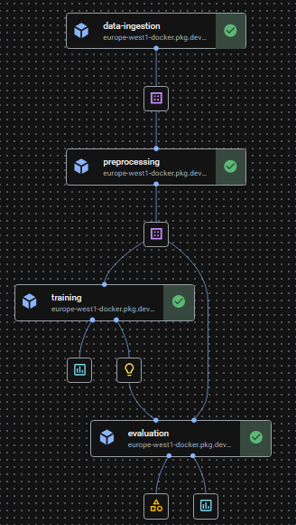

# Fake-or-Proof

Image classification application deployed on **Google Cloud Run**, with a **Vertex AI** training pipeline. MobileNetV2 estimates whether an image is AI-generated or real; GradCAM can illustrate its influential regions. A prediction is not proof of authenticity.

**Application:** [Open Fake-or-Proof](https://fakeorproof-streamlit-ffck35mifa-ew.a.run.app).

This repository targets cloud deployment. Runtime code is in `fake_or_proof/`, the Streamlit interface is in `app.py`, and automated checks and their fixtures are grouped under `.github/`. The example images in `dataset/subset/` are retained as dataset resources and excluded from runtime images. Local launch scripts and bootstrap benchmarks are not included.

## Dataset

Dataset reference: [AI-generated images vs real images](https://www.kaggle.com/datasets/tristanzhang32/ai-generated-images-vs-real-images), published on Kaggle by Tristan Zhang (`tristanzhang32`).

The Kaggle dataset page lists the dataset under the [MIT License](https://opensource.org/license/mit). The example images in `dataset/subset/` retain the dataset's original licensing terms. Preserve the upstream copyright and license notices when redistributing these images.

## Deploy to Cloud Run

The GitHub Actions deployment workflow builds the application image, runs the required checks, publishes a commit-tagged image to Artifact Registry and updates the configured Cloud Run service. Deployment authentication uses Workload Identity Federation; no service-account private key is required.

Configure the existing Cloud Run service, Artifact Registry repository, federation provider and deployment/runtime service accounts using [the deployment guide](.github/DEPLOYMENT.md). Set these repository variables:

| GitHub Actions variable | Purpose |
| --- | --- |
| `GCP_PROJECT_ID` | Your Google Cloud project ID |
| `GCP_REGION` | Region of the service and registry |
| `GCP_ARTIFACT_REPOSITORY` | Artifact Registry repository |
| `GCP_CLOUD_RUN_SERVICE` | Cloud Run service name |
| `GCP_RUNTIME_SERVICE_ACCOUNT` | Cloud Run runtime service-account email |

Set `GCP_WORKLOAD_IDENTITY_PROVIDER` and `GCP_DEPLOY_SERVICE_ACCOUNT` under repository **Secrets**. The guide explains the restricted repository/branch federation binding and required IAM roles.

When publication is authorized, a matching push to `main` deploys automatically. The workflow can also be started with **Actions → Deploy Streamlit → Run workflow** on `main`. It preserves the service URL and existing access policy. No workflow starts Vertex training automatically.

## Model and runtime configuration

By default the Cloud Run image contains the trained release artifact and its trusted SHA-256 manifest. This avoids a model-bucket dependency at startup and requires **no Firestore access**. The runtime verifies integrity before restricted loading and runs a real prediction before opening HTTP on Cloud Run's `PORT`.

Alternatively, configure these repository variables together to use a trusted GCS model:

| Optional variable | Value |
| --- | --- |
| `FOP_MODEL_URI` | `bundled` (default), or `gs://YOUR_BUCKET/models/SHA256.pth` |
| `FOP_MODEL_SHA256` | Expected SHA-256 from a trusted pipeline release; required for GCS |

The deployment workflow transfers these settings to Cloud Run and enforces the 5 MB upload ceiling. The runtime accepts the packaged artifact or a GCS URI; arbitrary filesystem model paths are not supported. For GCS, grant the runtime identity read-only access to that object. Do not grant it model-write or database permissions.

## Security behavior

- Each visitor's last 100 predictions belong to that session. There is no shared history collection, global export or global delete operation. Filenames are not recorded; exports use JSON.
- JPEG/PNG uploads are limited to 5 MB, 50–4096 pixels per side and 12 megapixels. Animated, malformed and truncated images are rejected before inference; metadata is discarded.
- Model artifacts contain tensors and validated primitive metadata. Loading uses `weights_only=True` with strict architecture, label, preprocessing and tensor checks; there is no unrestricted-pickle fallback.
- Inference and GradCAM share a nonblocking lock, a per-session cooldown and a bounded CPU thread count. Hooks and gradients are cleaned up after errors.
- The application image runs as UID 10001. Python base images use immutable digests; Python dependencies and CPU wheels use the universal `uv.lock` with hashes. GitHub actions use verified commit references.
- User-facing errors are generic; diagnostic details go to server logs. Cloud Run is configured for one instance, four concurrent requests and a five-minute request timeout.

Session/media lifetimes are managed by Streamlit. This application does not provide an authenticated storage service or immediate secure memory erasure. Apply appropriate ingress controls and quotas for the expected audience.

## Automated checks

GitHub Actions runs Linux application/pipeline tests, two-session isolation checks, image-validation and artifact-integrity checks, restricted deserialization, concurrency and GradCAM cleanup tests. It builds both images, validates runtime inference without network access and scans for fixable high/critical image vulnerabilities. The entire dependency lock is audited against public advisories.

Tests and CI utilities live in `.github/tests/` and `.github/scripts/`; they are excluded from production images. Test cloud access is simulated and never starts a billable job.

## Train in Vertex AI

The training pipeline is separate from application deployment. It persists train/validation/test partitions, trains MobileNetV2, reports test metrics and promotes using validation AUC. Selected models are published under immutable content-addressed object names with a dedicated `published_manifest` output containing the URI/hash.

Example of a successful pipeline execution in Vertex AI.

Follow [pipeline setup](pipeline/README.md) for execution in your Google Cloud project. Project, region, buckets, runtime identity and image digest are explicit configuration; no author's cloud resources are selected by default.

The `EDA/` and modeling notebooks are historical research inputs, and dataset CSV files document training data. They are excluded from both runtime images. Historical HTML templates are not served by Streamlit. This project has no REST prediction API.

## License

The project's source code is licensed under the [MIT License](LICENSE).
Third-party datasets, images, model weights and dependencies retain their respective licenses.
